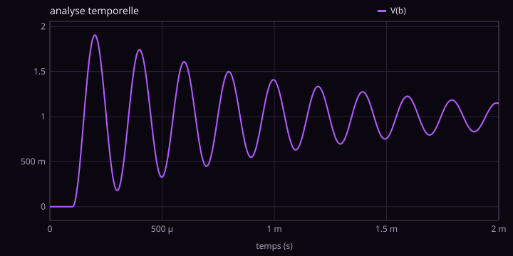
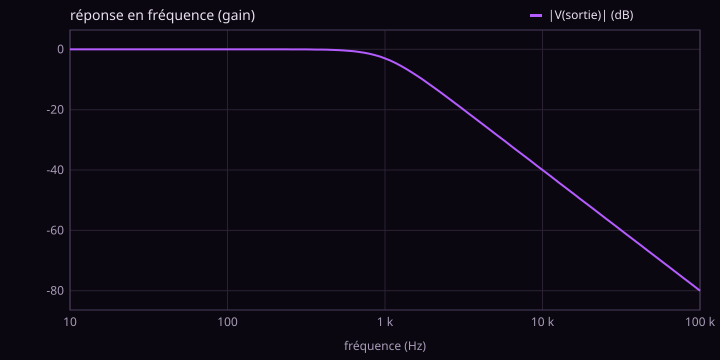
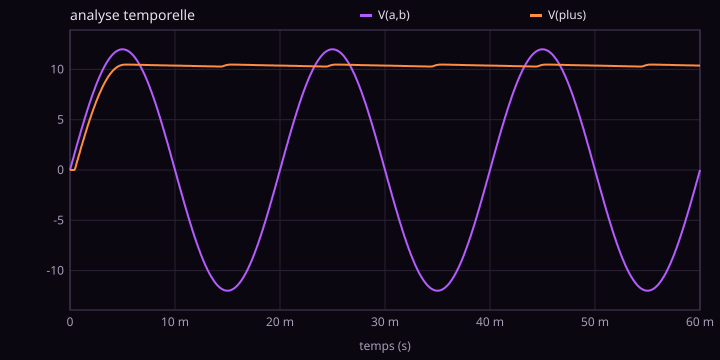

# circuit-spice

Un simulateur de circuits électriques façon **SPICE**, écrit de zéro en Python pur : pas de numpy, pas de scipy. On décrit le circuit dans un fichier texte, le programme écrit les lois de Kirchhoff sous forme de matrice et les résout.







## Utilisation

```sh
python3 circuit.py exemples/rc.cir                 # courbes dans le terminal
python3 circuit.py exemples/rlc.cir --svg images   # + graphiques SVG
python3 tests.py                                   # 13 comparaisons avec la théorie
```

Une netlist ressemble à ça :

```
* Filtre RC passe-bas
V1 entree 0 PULSE(0 5 0.5m 1u 1u 10m 20m) AC 1
R1 entree sortie 1k
C1 sortie 0 1u
.tran 10u 6m
.ac dec 20 1 100k
.sonde V(entree) V(sortie)
```

| Ligne | Sens |
|---|---|
| `R1 a b 4.7k` | résistance (aussi `C`, `L`) ; suffixes `f p n u m k meg g` |
| `V1 a b 5` | source de tension ; aussi `SIN(décalage amplitude fréquence)`, `PULSE(v1 v2 retard montée descente largeur période)`, `PWL(t1 v1 t2 v2 ...)`, `AC amplitude` |
| `I1 a b 1m` | source de courant (de a vers b à travers la source) |
| `D1 anode cathode IS=2.5n N=1.75` | diode (loi de Shockley) |
| `E1 s 0 p m 100k` | source de tension commandée : V(s) = 100 000·(V(p) − V(m)), un AOP idéal |
| `.op` `.dc V1 0 5 0.1` `.tran pas fin` `.ac dec n f1 f2` | les quatre analyses |
| `.sonde V(n) V(a,b) I(V1)` | ce qu'on veut tracer |

Exemples fournis : pont diviseur, RC, RLC, pont de diodes, caractéristique d'une diode, amplificateur inverseur, filtre de Sallen-Key.

## Comment ça marche

### Analyse nodale modifiée (MNA)

Les inconnues sont les tensions des nœuds (la masse vaut 0) et le courant de chaque source de tension. Chaque composant ajoute sa contribution, son « tampon », dans une matrice `A` et un second membre `b`, puis on résout `A·x = b` par élimination de Gauss avec pivot partiel.

- une résistance entre `a` et `b` ajoute `1/R` en `(a,a)` et `(b,b)`, retire `1/R` en `(a,b)` et `(b,a)` : c'est la loi des nœuds ;
- une source de tension ajoute une ligne `V(a) − V(b) = E` et une colonne pour son courant.

### Temporel : modèles compagnons

Un condensateur obéit à `i = C·dv/dt`. Avec un pas `h`, la **règle des trapèzes** donne

```
i(n+1) = (2C/h)·(v(n+1) − v(n)) − i(n)
```

C'est une conductance `2C/h` en parallèle avec une source de courant qui ne dépend que du passé : à chaque pas, le circuit redevient un circuit de résistances et de sources. Même chose pour une bobine. Le premier pas utilise Euler implicite, qui amortit le choc du démarrage.

### Diodes : Newton-Raphson

`i = Is·(e^(v/nVt) − 1)` n'est pas linéaire. On la remplace par sa tangente au point courant (une conductance plus une source de courant), on résout, on recommence jusqu'à ce que plus rien ne bouge. Deux détails repris de SPICE :

- **limitation de pas** (`pnjlim`) : si Newton propose 5 V aux bornes d'une diode, `e^(5/0.026)` déborde ; on raccourcit le pas de façon logarithmique ;
- **gmin** : une fuite de 10⁻¹² S en parallèle de chaque diode. Elle doit être une vraie conductance (dans le courant *et* dans la matrice), sinon Newton converge à pas de fourmi : c'est exactement ce qui bloquait le pont de diodes au début.

### Fréquentiel : nombres complexes

Le circuit est linéarisé autour de son point de repos, puis résolu pour chaque fréquence avec des admittances complexes : `jωC` pour un condensateur, `1/(jωL)` pour une bobine. Le même code de Gauss marche tel quel, puisque Python sait diviser des complexes.

## Vérifications (`tests.py`)

```
ok  diviseur : V(b) = 12·4.7/14.7
ok  RC : V(s) à t = τ vaut 5·(1 − 1/e)
ok  RC : gain à fc                          -3.0103 dB
ok  RC : phase à fc                         -45°
ok  RLC : fréquence du pic f0·√(1 − 1/2Q²)
ok  RLC : hauteur du pic Q/√(1 − 1/4Q²) en dB
ok  RLC : pseudo-période 2π/√(ω0² − α²)
ok  inverseur : gain −R2/R1 = −10 → 20 dB
ok  inverseur : déphasage 180°
ok  Sallen-Key : -3 dB à fc
ok  Sallen-Key : pente en dB par décade     -40
ok  diode : V à 1 mA = n·Vt·ln(1 + I/Is)
ok  pont de diodes : tension moyenne en sortie
```

## Limites

Pas de transistors, pas de pas de temps adaptatif, pas de matrices creuses : c'est fait pour comprendre, et pour des circuits de quelques dizaines de composants.
